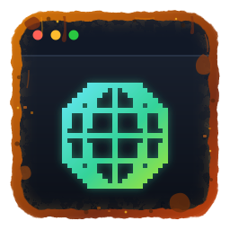
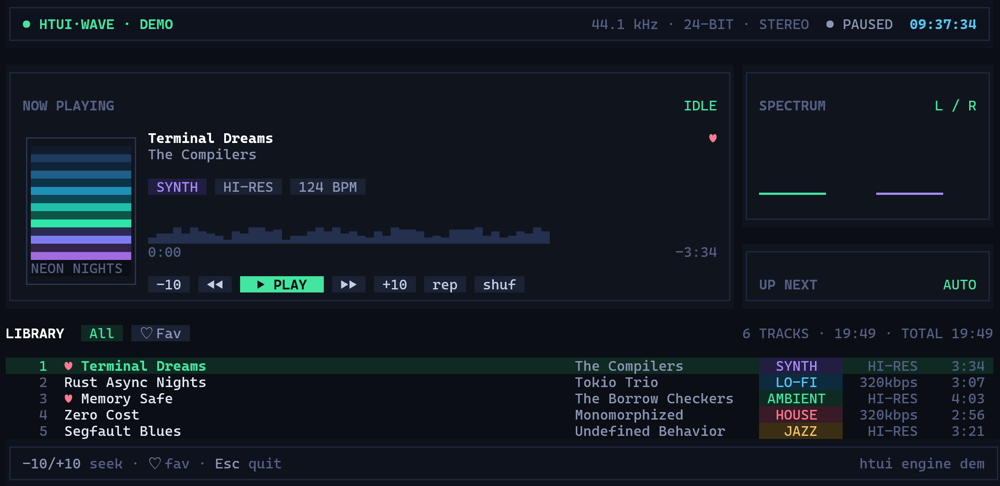
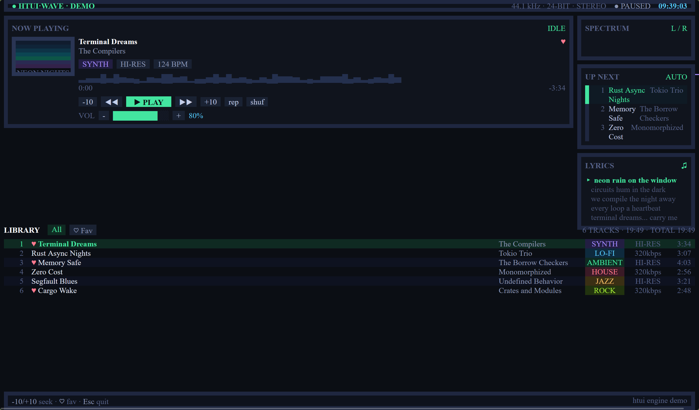

<p align="center">
  
</p>

# htui

**Write interactive terminal interfaces with HTML, CSS and JavaScript**

[](https://crates.io/crates/htui)
[](https://docs.rs/htui)
[](https://github.com/dDostalker/htui)
[](https://www.rust-lang.org)

[中文说明](README.zh-CN.md)

`htui` is a Rust library that renders HTML documents in the terminal to build
TUIs, with partial CSS and script support. It aligns as closely as possible
with the pure-HTML development experience, functionality and ease of use —
delivering as many features as possible while keeping the library as easy as
possible to pick up.

> This project is in an early stage of rapid development. No stability
> guarantees are made for the API, the rendered interface, or the internal
> implementation — use with caution.

## Quick start

```sh
cargo add htui
```

```rust
use htui::Session;

fn main() {
    let mut session = Session::new();
    session.render(
        r#"
        <h1 style="color: steelblue">Hello, htui</h1>
        <p>Press <b>Esc</b> to quit.</p>
        "#,
        "",
    );
}
```

Interactivity is one attribute away — `<button onclick="greet()">`, backed by
a `#[htui::command]` Rust function. See the tutorials below.

## Example: terminal music player

`example/` ships a complete music player UI — album art, progress bar,
transport controls, and a playlist with hover and selection highlighting.
It is an interface + interaction demo only; no audio is played. Run it:

```bash
cd example
cargo run
```

| Terminal — `cargo run` | Browser — same `player.html` |
| --- | --- |
|  |  |

## Documentation

| Document | Content |
| --- | --- |
| [docs.rs/htui](https://docs.rs/htui) | API reference |
| [Tutorial: HelloWorld](docs/zh-cn/教程/1.HelloWorld.md) | Your first page |
| [Tutorial: Static terminal](docs/zh-cn/教程/2.实现静态终端.md) | Disabling the event system, render configuration |
| [Tutorial: Resources](docs/zh-cn/教程/3.0资源.md) | The `mem://` concept |
| [Tutorial: Registering and reading resources](docs/zh-cn/教程/3.1资源的注册和读取.md) | The `mem://` operations manual |
| [Tutorial: Dynamic terminal](docs/zh-cn/教程/4.0动态终端.md) | Events, timers, built-in keys |
| [Tutorial: JS and Rust bindings](docs/zh-cn/教程/4.1JS和Rust绑定.md) | Host functions, interop |
| [Architecture](docs/zh-cn/架构.md) | Render pipeline and threading model |
| [Boundary document](docs/zh-cn/边界文档.md) | Goals, promises and rejection list |
| [Capability matrix](docs/zh-cn/能力差异清单.md) | Full comparison against browsers |
| [Script layer reference](docs/zh-cn/教程/script-layer.md) | In-depth script layer documentation |

## Platform

Rust **1.89+** (edition 2024).

## License

Dual-licensed under [Apache-2.0](LICENSE-APACHE) or [MIT](LICENSE-MIT), at your option.
